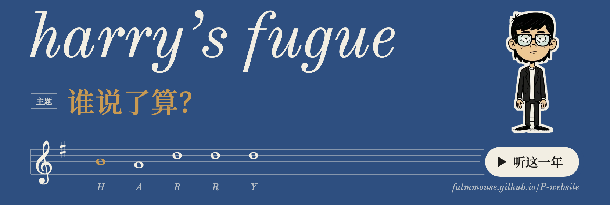

个人网站是一份可以播放的乐谱。五条线是五类事，每个音符是 2026 年里真实发生过的一件事。**[▶ 去听这一年](https://fatmmouse.github.io/P-website/)**

| 声部 | 这一行问的 | 先看这一件 |
| :-- | :-- | :-- |
| V 玩 | 好不好看，他说了算。 | [Folip](https://github.com/fatmmouse/Folip)：在 Mac 上放下一份文件，回头用手机取走 |
| IV 欲望 | 想要什么，谁说了算？ | [不可抵达的对象](https://fatmmouse.github.io/P-website/posts/unreachable-object/)：用拉康读《将军底头》 |
| III 钩子 | 买不买，谁说了算？ | [去蜜雪买冰淇淋，结果零食也买了](https://fatmmouse.github.io/P-website/posts/mixue-snacks/) |
| II 自己 | 几点睡，谁说了算？ | [数据人生](https://fatmmouse.github.io/P-website/works/data-life/)（进行中） |
| I 模型 | 做没做完，谁说了算？ | [三代 Opus，105 条轨迹](https://fatmmouse.github.io/P-website/works/opus-lineage/) |

harry，香港中文大学（深圳）统计学，2027 届。关注 Agent 评测，在找算法、后训练方向的机会。  
[关于](https://fatmmouse.github.io/P-website/about/) · fatmmouse@gmail.com · 小红书「硕鼠」@harrysfugue
